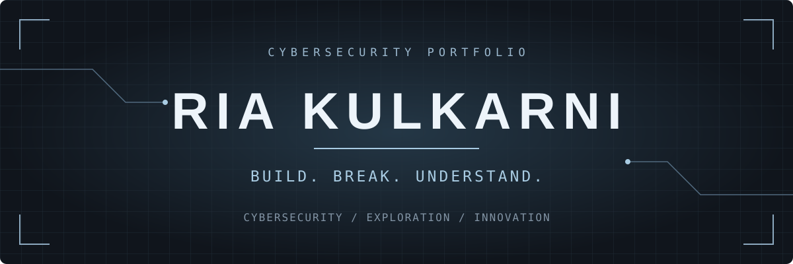

  

## 01 / About Me

I'm a final-year Information Technology undergraduate passionate about cybersecurity.

My journey began with Vulnerability Assessment and Penetration Testing (VAPT), building a foundation in offensive security. I'm currently exploring AI security through adversarial experimentation and defense evaluation.

With an interest in purple teaming, I aim to understand cybersecurity from both offensive and defensive perspectives. I enjoy building security platforms, experimenting with emerging threats and turning what I learn into practical projects.

---

## 02 / Featured Projects

### [ExploitArena](https://github.com/riaxk/ExploitArena)

**AI-Powered Cybersecurity Training & Report Analysis**

A cybersecurity learning platform focused on realistic security simulations, vulnerability reporting and AI-assisted learning.

- Three arenas: Offensive Security, Blue Team and Digital Trust
- AI Mentor and intelligent report analysis
- 44 user feedback responses
- Currently in private beta

`Next.js` `FastAPI` `PostgreSQL` `Docker` `Redis`

### [AIShield](https://github.com/riaxk/AIShield)

**Adversarial Security Benchmarking & Defense Evaluation**

An experimental framework investigating prompt injection and knowledge base poisoning in RAG-based LLM applications.

| Experimental metric | Result |
| :--- | :--- |
| Test scenarios | 60 |
| Local LLMs | 2 |
| Defense configurations | 4 |
| Experimental runs | 480 |
| Relative reduction in attack success | 69% |
| Normal-query accuracy | 100% |

Includes an interactive research dashboard, experimental datasets, technical documentation and reproducibility guidelines.

`Python` `FastAPI` `React` `Ollama` `RAG`

### [Drone SOC](https://github.com/riaxk/Drone-SOC)

**Drone Network Traffic Analysis & Attack Detection**

Developed during my Defence Space internship, integrating machine learning with network traffic analysis and threat detection.

`Python` `FastAPI` `Next.js` `Random Forest` `Docker`

---

## 03 / Technical Toolkit

**Security Tools**

**Languages & Development**

**AI & Infrastructure**

---

## 04 / Currently Exploring

- AI Security and LLM vulnerabilities
- Adversarial attacks and defense evaluation
- Defensive security and Blue Team fundamentals
- Purple teaming methodologies

---

## 05 / Learning & Milestones

| Platform | Achievement |
| :--- | :--- |
| TryHackMe | Top 6% |
| TryHackMe | Jr. Penetration Tester Learning Path |
| EC-Council | C\|CT Scholarship Recipient |
| Microsoft Learn | AI Security Fundamentals |

---

  <b>BUILD. BREAK. UNDERSTAND.</b>
   
  Driven by curiosity. Focused on cybersecurity.

<!--
**riaxk/riaxk** is a ✨ _special_ ✨ repository because its `README.md` (this file) appears on your GitHub profile.

Here are some ideas to get you started:

- 🔭 I’m currently working on ...
- 🌱 I’m currently learning ...
- 👯 I’m looking to collaborate on ...
- 🤔 I’m looking for help with ...
- 💬 Ask me about ...
- 📫 How to reach me: ...
- 😄 Pronouns: ...
- ⚡ Fun fact: ...
-->
